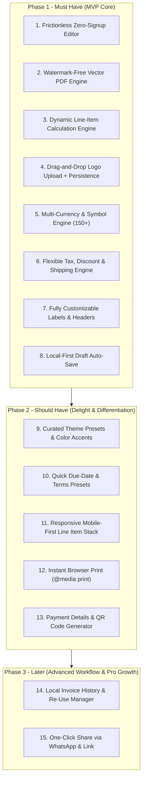

# Competitor Teardown & Strategic Feature Roadmap

**Project**: Online Invoice Creator (`onlineinvoicecreator.com`)  
**Phase**: Phase 1 — Competitor Teardown and Feature List  
**Date**: October 2026  
**Document**: `docs/competitor-notes.md`

---

## 1. Executive Summary & Market Landscape

The online invoice generation market is split into two primary product tiers:
1. **Utility-First Free Generators (e.g., Invoice-Generator.com)**:
   - Zero signup friction, instant single-page editor, instant PDF download.
   - High organic search volume and customer loyalty due to lack of paywalls and lack of intrusive watermarks.
   - Monetization relies primarily on programmatic ad networks (e.g., Playwire skyscrapers) and upselling accounts/APIs.
2. **Aggressive Freemium / SaaS Platforms (e.g., Invoice Simple, Refrens, Invoicer.ai)**:
   - High conversion friction: users create an invoice only to encounter a hard paywall or mandatory signup before downloading.
   - Intrusive watermarks on free tiers ("Created with Invoice Simple" / "Powered by Refrens").
   - Feature-rich backends (estimating, inventory, CRM, automated payment reminders, payment gateways), but frustrating for one-off and quick-billing users.

**Our Core Strategic Opportunity**:  
Build the fastest, most beautiful (Revolut-inspired fintech aesthetic), privacy-first, 100% watermark-free invoice creator with zero mandatory signup. Provide frictionless utility that beats `invoice-generator.com` on design and mobile UX, while eliminating the predatory paywalls of `Invoice Simple`.

---

## 2. Competitor Teardown Matrix

The following matrix compares **Invoice-Generator.com** (primary competitor) with **InvoiceSimple.com** and **Refrens.com**, alongside insights from **Invoicer.ai** and **FreeInvoiceBuilder.com**.

| Feature / Criteria | Invoice-Generator.com (Primary) | Invoice Simple (`invoicesimple.com`) | Refrens (`refrens.com`) | Invoicer.ai | FreeInvoiceBuilder.com |
| :--- | :--- | :--- | :--- | :--- | :--- |
| **Primary Value Prop** | "Free Invoice Generator — 1-click PDF, trusted by 4M+" | "Simple invoicing on-the-go for contractors & trades" | "GST & international invoicing with accounting tools" | "AI-powered invoice & estimate generator" | "Free online invoice maker & templates" |
| **Fields Offered** | • Header title (editable) • Invoice # & PO # • Bill From (textarea) • Bill To & Ship To • Date & Due Date • Payment Terms • Line items (Name, Qty, Rate, Amount) • Subtotal, Tax, Shipping, Discount • Amount Paid & Balance Due • Notes & Terms | • Header title & Business info • Client name & contact import • Invoice & PO numbers • Issue date & Due date • Line items with item photo support • Discounts (line & total) • Multi-rate tax • Signature line & custom fields | • Document types: Tax Invoice, Proforma, Quote, Delivery Challan • Custom column headers • HSN/SAC codes (GST) • Client GSTIN / Tax ID • Line items with individual tax rates • TDS/TCS & cess • Bank details & digital signature | • Voice/text AI prompt generator • Line items with AI pricing suggestions • Deposit & milestones • Client address directory • Terms & private internal notes | • Standard Bill From / To • Invoice # and dates • Line items (Quantity, Rate) • Basic Tax & Discount • Payment terms & notes |
| **Templates** | Single minimalist template (paper aesthetic); dark/light theme switch; emerald accent highlights. | 60+ pre-formatted industry templates (construction, freelance, cleaning); accent color picker. | 12+ modern layouts (Classic, Modern, Sleek, Minimal); "Magic Color" extracts theme from logo. | 3 modern contractor/clean layouts; brand color tinting. | 4 basic HTML table templates categorized by profession and country. |
| **Logo Upload** | Direct drag-and-drop / file selector in top-left; supports PNG, JPG, SVG; client-side image preview. | High-res logo upload, auto-scales to header letterhead; square or rectangle bounding. | Logo upload with auto-color palette generation; supports secondary digital signature image. | Logo upload in canvas with live PDF preview. | Logo upload via standard file picker; limited scaling options. |
| **Tax & Discount Handling** | Summary-level toggles: • Tax: Percent (%) or Flat ($) or Off • Discount: Percent (%) or Flat ($) or Off • Shipping: Flat ($) or Off | Item-level and summary-level discounts and taxes; supports compound tax, VAT, inclusive/exclusive pricing. | Highly advanced: Multi-tier tax engine (CGST/SGST/IGST, VAT, global sales tax for 175+ countries), item-level tax, reverse charge. | Dollar ($) and Percentage (%) discounts; milestone deposits; automated state sales tax rates. | Simple flat or percentage summary-level calculation. |
| **Currencies** | 160+ ISO world currencies with auto-symbol formatting ($100 vs 100 €). | 130+ global currencies with locale formatting. | 150+ currencies with multi-currency exchange rate handling. | 135+ currencies backed by Stripe payments. | ~30 major global currencies. |
| **PDF Quality** | High-quality vector PDF rendered via serverless Chrome; selectable text, embedded fonts, clean pagination. | Vector PDF with embedded clickable payment links and crisp typography; A4 and US Letter sizes. | High-res vector PDF with optional embedded QR code (payment link/UPI), crisp lines and font rendering. | High-quality vector PDF with clean modern cards and clickable buttons. | Variable quality HTML-to-PDF print rendering; occasional line breaks across pages. |
| **Signup or Paywall Points** | **No signup required** for unlimited generation and PDF download. Signup only needed for cloud history & API. | **Aggressive paywall**: 1-3 free trial invoices, then locks PDF download behind $6.99–$19.99/mo subscription. | Free generator available; signup required to send via WhatsApp/email or store client database; paid tier for CRM/accounting. | 14-day free trial, then hard paywall ($12–$25/month). | Free with account prompt; redirects to app subdomain for full feature access. |
| **Watermark** | **100% Watermark-Free** on all free downloads. | Free/trial PDFs carry "Created with Invoice Simple" footer badge. | Free tier includes subtle "Powered by Refrens" footer watermark. | Watermark-free on paid; trial carries branding footer. | Subtle branding link in footer on free tier. |
| **Ads & Popups** | Display banner ads via Playwire ad network (left & right skyscraper rails on >1288px screens). No blocking popups. | No external display ads, but persistent internal upgrade popups, trial countdowns, and paywall modals. | No third-party display ads; in-app upsells for CRM, GST filing, and subscription tiers. | No display ads; trial upgrade banners and modals. | Google AdSense display banners in header, sidebar, and footer. |
| **Mobile Behaviour** | Responsive web app; switches line items from desktop grid to mobile stacked cards (Description, then Qty/Rate, then Amount). Sticky bottom action button. | Dedicated native iOS & Android apps; mobile web redirects strongly towards app download. | Responsive web layout; horizontal scroll on wide tables; WhatsApp-first mobile sharing. | Clean PWA-ready responsive layout; touch-friendly cards and voice input. | Basic responsive table; difficult to edit small input fields on phone screens. |
| **Page Speed & Tech** | Fast (~1.2s - 1.8s LCP); static HTML + Tailwind CSS with React hydration; minimal bloat. | Moderate (~2.5s - 3.2s LCP); heavy tracking, analytics, and paywall SDKs. | Moderate (~2.8s - 3.5s LCP); Framer/Next.js dynamic assets and analytics scripts. | Fast initial load (~1.6s LCP); Webflow landing page + React dashboard. | Slow (~3.5s - 4.2s LCP); WordPress + WPBakery + third-party AdSense scripts. |

---

## 3. Detailed Competitor Teardown

### 3.1 Competitor 1: Invoice-Generator.com (Benchmark Competitor)

#### Overview
`invoice-generator.com` is the gold standard for web utility invoicing. Created originally as a lightweight developer tool and invoice API, it grew into one of the most visited invoicing websites globally.

#### Key Strengths
- **Instant Usability**: Zero landing page fluff; the homepage IS the editor. Users are typing within 1 second of landing.
- **Watermark-Free & Free**: Does not punish free users with watermarks. This builds immense goodwill and massive organic backlinks.
- **Smart Mobile Adaptation**: Transitions from a 4-column desktop line-item table (`Amount`, `Rate`, `Quantity`, `Description`) to a stacked card component on viewports `< 768px`.
- **Customizable Labels**: Every label is an editable input (e.g. users can rename "Tax" to "GST", "Invoice" to "Bill", "Due Date" to "Expiry").
- **160+ Currencies**: Comprehensive currency support with auto-updating currency symbols.

#### Key Weaknesses & UX Friction
- **Ad Clutter**: Heavy skyscraper ads (`ramp.spaAddAds` via Playwire) on wide screens (`> 1288px`), creating visual noise and layout shift.
- **Outdated Single Template**: Only 1 template available. No modern design themes, font options, or contemporary styling.
- **No Client-Side PDF Generation**: PDF download posts back to `/pdf` server endpoint; if the server is congested or down, download fails.
- **Rudimentary Tax/Discount**: Only supports single global tax and discount; no item-level taxes or multi-rate VAT/GST.
- **No Payment QR Code**: Lacks modern QR code generation for instant mobile payment (e.g., UPI, SEPA, Venmo, PayPal, Crypto).

---

### 3.2 Competitor 2: Invoice Simple (`invoicesimple.com`)

#### Overview
`invoicesimple.com` is a commercial powerhouse targeting tradespeople, home service contractors, and mobile-first small businesses.

#### Key Strengths
- **Industry Presets**: 60+ customizable templates specifically tailored for trades (landscaping, plumbing, automotive, cleaning).
- **Client Auto-Complete**: Caches previous client names and item descriptions for fast auto-fill.
- **Signature Capture**: Built-in digital touch signature capture directly on the invoice.
- **Stripe Payment Integration**: Generates "Pay Now" links directly on invoice PDFs.

#### Key Weaknesses & UX Friction
- **Bait-and-Switch Paywall**: Users spend 10 minutes meticulously creating an invoice only to be blocked by a hard paywall demanding payment before download.
- **Watermark**: Trial documents stamp "Created with Invoice Simple" across the bottom.
- **Mobile Web Downgrade**: Web experience aggressively pushes the user to download the native app from the App Store/Google Play rather than completing the invoice in-browser.
- **Heavy Bloat**: Slower page load with heavy analytics, trackers, and subscription gatekeepers.

---

### 3.3 Competitor 3: Refrens (`refrens.com`)

#### Overview
`refrens.com` is a B2B invoicing, accounting, and GST compliance platform targeting freelancers and agencies in India, Southeast Asia, and global markets.

#### Key Strengths
- **Deep Compliance & Tax Engine**: Handles GST (CGST, SGST, IGST), reverse charge, HSN/SAC lookup, TDS/TCS, and international VAT for 175+ countries.
- **Magic Color Tool**: Automatically samples colors from an uploaded business logo and applies matching accent palettes to the invoice.
- **Multi-Document Workflow**: Converts Quotation $\rightarrow$ Proforma $\rightarrow$ Tax Invoice $\rightarrow$ Receipt with 1 click.
- **Omnichannel Delivery**: Direct share via WhatsApp link, email, or client portal.

#### Key Weaknesses & UX Friction
- **Mandatory Signup Friction**: Even basic actions frequently prompt for phone number/OTP or email registration.
- **Feature Overload**: Interface feels like an accounting suite with sidebar navigation, CRM leads, and inventory tracking, overwhelming users who just need a quick invoice.
- **Watermarking**: Subtle branding on free-tier documents.

---

### 3.4 Competitor 4 & 5: Invoicer.ai & FreeInvoiceBuilder.com (Key Takeaways)

- **Invoicer.ai**:
  - *Strength*: Incorporates AI prompting ("Create an invoice for Mike Smith, deck framing labor $1,850 and materials $2,400") to generate line items automatically.
  - *Weakness*: 14-day trial followed by $12–$25/month subscription; no free permanent utility.
- **FreeInvoiceBuilder.com**:
  - *Strength*: Good SEO content collections for profession-specific templates.
  - *Weakness*: Legacy WordPress architecture, intrusive Google AdSense ads, outdated aesthetics, and redirect chains to subdomains.

---

## 4. Gap Analysis: Where We Win

| Dimension | Typical Competitor Problem | Our Strategic Advantage |
| :--- | :--- | :--- |
| **Friction** | Traps user behind signup or surprise paywall. | **100% Free, Zero Mandatory Signup, No Paywall**. |
| **Visual Design** | Looks like 2014 enterprise software or cluttered with skyscraper ads. | **Revolut-inspired premium fintech aesthetics**: clean cobalt violet accents (`#494fdf`), Aeonik/Inter typography, pristine whitespace, zero ad clutter. |
| **PDF Generation** | Relies entirely on slow server-side rendering or puts watermarks on PDFs. | **Instant, high-fidelity, watermark-free vector PDF download** with client-side print fallback. |
| **Data Privacy** | Cloud tools store all client data on their databases without clear user control. | **Local-First & Privacy-Focused**: Invoices auto-save to browser `localStorage`. No client or financial data is harvested or tracked. |
| **Mobile UX** | Degraded mobile web designed only to force an App Store download. | **First-class mobile web interface**: thumb-friendly card layout, responsive controls, instant PDF generation on mobile. |
| **Payments** | Requires setting up merchant accounts on their platform. | **Instant Payment QR Code & Link generator** (UPI, PayPal, Stripe Link, Bank IBAN) embedded directly into the invoice footer. |

---

## 5. Ranked List of 15 Features to Build

The following 15 features are prioritized by impact on user acquisition, retention, and conversion, categorized into **"must"**, **"should"**, and **"later"**:

---

### Ranked Feature Specifications

| Rank | Feature Name | Priority | Category | Rationale & User Impact | Implementation Details |
| :---: | :--- | :---: | :--- | :--- | :--- |
| **1** | **Frictionless Zero-Signup Direct Invoicing** | **must** | Core UX | The primary acquisition magnet. Users can land on `onlineinvoicecreator.com`, fill details, and download a finished invoice in < 30 seconds without creating an account or providing credentials. | Root page `/` loads directly into an interactive invoice canvas. No splash screen or gating modals. |
| **2** | **Watermark-Free Vector PDF Generation** | **must** | Output Quality | Competitors use watermarks to force upgrades; offering 100% clean, professional, watermark-free PDFs creates massive word-of-mouth and backlink dominance. | Crisp typography and vector layout matching standard A4 and US Letter page geometry with correct page-break rules. |
| **3** | **Dynamic Line-Item Calculation Engine** | **must** | Core Engine | Real-time calculation of item quantity $\times$ unit rate $=$ line amount, subtotal accumulation, dynamic row addition, deletion, and keyboard tab navigation. | Pure reactive client-side math (zero rounding errors with fixed 2-decimal financial precision). |
| **4** | **Drag-and-Drop Logo Upload with Persistence** | **must** | Branding | Professional business invoices demand brand logos. Drag-and-drop file upload with instant client preview and auto-saving to `localStorage`. | Client-side image resizing, Base64 storage in `localStorage`, clean container constraints (max 200px $\times$ 100px). |
| **5** | **Comprehensive Multi-Currency Engine (150+)** | **must** | Localization | Freelancers and remote agencies bill across global borders. Must support USD ($), EUR (€), GBP (£), INR (₹), CAD, AUD, JPY (¥), and all ISO 4217 currencies with symbol placement logic. | Dropdown with search filter, automatic symbol placement (prefix vs suffix), and standard thousand/decimal separators. |
| **6** | **Flexible Tax, Discount & Shipping Engine** | **must** | Calculations | Essential for global billing: support percentage (%) and flat rate ($) for both discounts and taxes (inclusive/exclusive), plus optional shipping line item. | Toggleable fields for Tax, Discount, and Shipping with explicit formulas displayed on summary lines. |
| **7** | **Fully Customizable Document Labels & Headers** | **must** | Flexibility | Allows the tool to generate not just "INVOICE", but also "TAX INVOICE", "PROFORMA INVOICE", "RECEIPT", "QUOTATION", or non-English labels (e.g., "FACTURE", "RECHNUNG", "FACTURA"). | All static headers (Bill From, Bill To, PO Number, Date, Due Date, Rate, Notes) implemented as editable inline text fields. |
| **8** | **Local-First Draft Auto-Save & Privacy Protection** | **must** | Reliability & Trust | Users often accidentally refresh or close tabs. Draft auto-saves continuously to browser `localStorage`. Highlighting zero server-storage builds trust for sensitive financial data. | Debounced auto-save (300ms) to `localStorage`; "Clear form" and "Load last draft" recovery options; zero data transmitted to ad networks. |
| **9** | **Curated Modern Templates & Custom Accent Colors** | **should** | Aesthetics | Surpasses `invoice-generator.com`'s single rigid layout. Offers 4 sleek presets (Minimalist Clean, Modern Fintech, Executive Border, Compact Studio) + custom brand color picker. | CSS custom properties (`--brand-accent`, `--brand-surface`) dynamically driving invoice headers, table accents, and borders. |
| **10** | **Payment Terms & Due Date Quick-Presets** | **should** | Productivity | Reduces typing friction. Instant buttons for "Due on Receipt", "Net 15", "Net 30", "Net 60", which automatically calculate and update the Due Date calendar field. | Date utility that offsets Issue Date by $0, 15, 30, 45, 60$ days on 1 click. |
| **11** | **Responsive Mobile-First Line-Item Card Stack** | **should** | Mobile UX | Tables are unusable on mobile screens. Switch smoothly from a 4-column desktop table to touch-friendly stacked item cards on viewports $<768\text{px}$, with a sticky download bar. | Responsive CSS grid + breakpoint detection; auto-sync input values between mobile card fields and desktop table rows. |
| **12** | **Instant Browser Print Optimization (`@media print`)** | **should** | Reliability | Provides an instantaneous zero-latency print and "Save as PDF" option using native browser print dialog, ensuring functionality even on offline or slow connections. | Clean `@media print` CSS hiding controls, navigation, and background chrome, formatting invoice strictly onto A4/Letter pages with proper margins. |
| **13** | **Payment Details & Dynamic QR Code Generator** | **should** | Fintech Integration | Modern clients pay via UPI, Revolut, PayPal, or SEPA QR codes. Embeds an auto-generated QR code and payment instructions into the invoice footer. | Client-side QR code generator rendering payment URLs (e.g. `https://paypal.me/...`, `upi://pay?...`, SEPA EPC QR format) into SVG/Canvas. |
| **14** | **Local Invoice History & Re-Use Manager** | **later** | Retention | Allows repeat users to view a list of recent invoices created on their device, duplicate an existing invoice to bill again, or export invoice records to CSV/JSON. | `IndexedDB` storage with date-indexed records, duplicate action, search filter, and privacy-preserving browser-only storage. |
| **15** | **One-Click Share via WhatsApp & Secure Web Link** | **later** | Virality & Growth | Small businesses and freelancers frequently invoice clients directly over WhatsApp or SMS. Generate a pre-filled WhatsApp billing summary link and optional cloud share. | Formats encoded text payload: `https://wa.me/?text=Invoice%20INV-001%20for%20$500...` with optional hosted PDF view. |

---

## 6. Design System & Tech Stack Directives (Aligned with DESIGN.md)

Following the brand guidelines in `DESIGN.md`:
- **Color Tokens**:
  - Primary Accent: Cobalt-Violet (`#494fdf`), Bright (`#4f55f1`), Deep (`#3a40c4`)
  - Canvas: Pristine light surface (`#ffffff`) and dark mode canvas (`#000000`)
  - Ink & Body: Slate-charcoal ink (`#191c1f`), muted body text (`#505a63`), hairline dividers (`#e2e2e7` / `rgba(255,255,255,0.12)`)
  - Status Accents: Paid/Success teal (`#00a87e`), Warning orange (`#ec7e00`), Danger red (`#e23b4a`)
- **Typography**:
  - Display & Headings: `Aeonik Pro`, 500 weight, tight letter spacing
  - Body & Form Inputs: `Inter`, 400 & 500 weights, high legibility for numerical tabular figures
- **Components**:
  - Pill-shaped action buttons (`border-radius: 9999px` or rounded-md `rounded-lg`)
  - Clean card surfaces (`rounded-xl`, subtle border `1px solid var(--hairline-light)`)
  - Tabular financial numerals (`font-variant-numeric: tabular-nums`)
  - Micro-interactions: Smooth hover states, non-intrusive focus rings in primary cobalt-violet.

---

## 7. Next Steps for Phase 2
1. Finalize the invoice state machine schema (TypeScript interfaces for Document, LineItem, Tax, Discount, Client, Sender).
2. Implement the reactive calculation engine and local storage persistence layer.
3. Construct the clean, ad-free Revolut-style canvas layout with responsive mobile card adaptation.
4. Integrate the vector PDF generation and `@media print` stylesheets.
