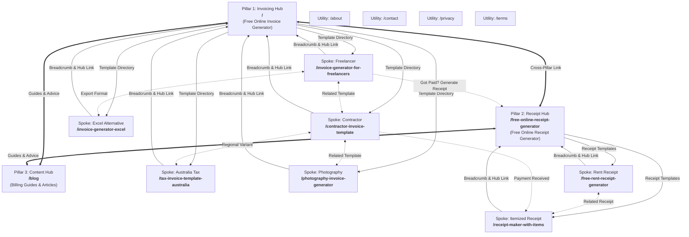

# Information Architecture & Internal Link Sitemap (Single Source of Truth)

**Project**: Online Invoice Creator (`onlineinvoicecreator.com`)  
**Phase**: Phase 2 — Information Architecture and URL Plan  
**Date**: October 2026  
**Document**: `docs/site-map.md`  
**Astro Enforcement**: `trailingSlash: 'never'` in `proud-parsec/astro.config.mjs`

---

## 1. Architectural Principles & URL Conventions

### 1.1 Strict URL Standard
1. **Lowercase Hyphenated Slugs**: All URLs must strictly use lowercase ASCII characters and hyphens for separation (e.g. `/invoice-generator-for-freelancers`). No underscores, camelCase, or URL-encoded spaces.
2. **Trailing-Slash Inconsistency Ban**:
   - **Enforced Policy**: **No trailing slashes** (`trailingSlash: 'never'`).
   - The homepage root is `/`. All sub-pages resolve strictly without a trailing slash (e.g. `https://onlineinvoicecreator.com/about`).
   - Enforced programmatically in `astro.config.mjs`:
     ```javascript
     export default defineConfig({
       site: 'https://onlineinvoicecreator.com',
       trailingSlash: 'never',
     });
     ```
3. **Canonical URLs**: Every page must declare a self-referencing canonical URL matching its exact protocol, domain, and trailing-slash rule (e.g. `<link rel="canonical" href="https://onlineinvoicecreator.com/contractor-invoice-template" />`).
4. **Locale**: English-only launch (`en-US`), `<html lang="en">` on all documents.

---

## 2. Master URL Registry (14 Pages)

| # | URL Path | Page Type | Cluster / Pillar | Primary H1 Target | Target Keyword | Search Intent |
| :-: | :--- | :---: | :---: | :--- | :--- | :--- |
| **1** | `/` | **Pillar 1** | Invoicing Pillar | Free Online Invoice Generator | free online invoice generator | Transactional / Tool |
| **2** | `/free-online-receipt-generator` | **Pillar 2** | Receipt Pillar | Free Online Receipt Generator | free online receipt generator | Transactional / Tool |
| **3** | `/free-rent-receipt-generator` | **Spoke** | Receipt Pillar | Free Rent Receipt Generator | free rent receipt generator | Transactional / Template |
| **4** | `/invoice-generator-for-freelancers` | **Spoke** | Invoicing Pillar | Invoice Generator for Freelancers | invoice generator for freelancers | Transactional / Persona |
| **5** | `/invoice-generator-excel` | **Spoke** | Invoicing Pillar | Free Online Invoice Generator to Excel & PDF | invoice generator excel | Transactional / Format |
| **6** | `/receipt-maker-with-items` | **Spoke** | Receipt Pillar | Online Receipt Maker with Itemized Products | receipt maker with items | Transactional / Tool |
| **7** | `/tax-invoice-template-australia` | **Spoke** | Invoicing Pillar | Free Tax Invoice Template Australia (ATO Compliant) | tax invoice template australia | Transactional / Regional |
| **8** | `/contractor-invoice-template` | **Spoke** | Invoicing Pillar | Free Contractor Invoice Template | contractor invoice template | Transactional / Persona |
| **9** | `/photography-invoice-generator` | **Spoke** | Invoicing Pillar | Photography Invoice Generator | photography invoice generator | Transactional / Persona |
| **10** | `/blog` | **Pillar 3** | Knowledge Hub | Invoicing & Small Business Billing Guides | invoicing guides & billing tips | Informational Hub |
| **11** | `/about` | **Utility** | Company Hub | About Online Invoice Creator | about online invoice creator | Informational / Trust |
| **12** | `/contact` | **Utility** | Support Hub | Contact Support & Feedback | contact invoice creator | Support / Contact |
| **13** | `/privacy` | **Utility** | Legal Hub | Privacy Policy — 100% Local-First Data | invoice creator privacy policy | Trust / Legal |
| **14** | `/terms` | **Utility** | Legal Hub | Terms of Service | invoice creator terms | Legal |

---

## 3. Topical Cluster & Link Architecture (Mermaid Diagram)



---

## 4. Internal Link Map & Anchor Text Directives

### 4.1 Global Navigation & Footer Matrix

All 14 pages inherit links from the global layout headers and footers:

#### Global Header Navigation
- **Logo (`/`)**: Links to Home (Pillar 1).
- **Invoice Generator (`/`)**: Active state on Pillar 1 and Invoicing Spokes.
- **Receipt Generator (`/free-online-receipt-generator`)**: Active state on Pillar 2 and Receipt Spokes.
- **Templates (Dropdown)**:
  - Freelancers (`/invoice-generator-for-freelancers`)
  - Contractors (`/contractor-invoice-template`)
  - Australia GST (`/tax-invoice-template-australia`)
  - Photography (`/photography-invoice-generator`)
  - Rent Receipt (`/free-rent-receipt-generator`)
  - Itemized Receipt (`/receipt-maker-with-items`)
  - Excel Alternative (`/invoice-generator-excel`)
- **Blog (`/blog`)**: Knowledge Base.

#### Global Footer Grid (4-Column Hierarchy)
1. **Column 1 — Invoicing Tools**:
   - [Free Invoice Generator](file:///) (`/`)
   - [Freelancer Invoice Generator](file:///invoice-generator-for-freelancers) (`/invoice-generator-for-freelancers`)
   - [Contractor Invoice Template](file:///contractor-invoice-template) (`/contractor-invoice-template`)
   - [Photography Invoice Creator](file:///photography-invoice-generator) (`/photography-invoice-generator`)
   - [Australia Tax Invoice Template](file:///tax-invoice-template-australia) (`/tax-invoice-template-australia`)
   - [Excel Invoice Generator](file:///invoice-generator-excel) (`/invoice-generator-excel`)
2. **Column 2 — Receipt Makers**:
   - [Free Receipt Generator](file:///free-online-receipt-generator) (`/free-online-receipt-generator`)
   - [Rent Receipt Generator](file:///free-rent-receipt-generator) (`/free-rent-receipt-generator`)
   - [Itemized Receipt Maker](file:///receipt-maker-with-items) (`/receipt-maker-with-items`)
3. **Column 3 — Knowledge & Resources**:
   - [Invoicing Blog & Guides](file:///blog) (`/blog`)
   - [How to Invoice Clients (Guide)](file:///blog) (`/blog`)
   - [GST Invoicing Rules (ATO)](file:///tax-invoice-template-australia) (`/tax-invoice-template-australia`)
4. **Column 4 — Company & Trust**:
   - [About Us](file:///about) (`/about`)
   - [Contact & Feedback](file:///contact) (`/contact`)
   - [Privacy Policy (Local-First)](file:///privacy) (`/privacy`)
   - [Terms of Service](file:///terms) (`/terms`)

---

## 5. Detailed Page-by-Page Linking Specifications

### Page 1: `/` — Free Online Invoice Generator (Pillar 1)
- **Role**: Primary Invoicing Pillar & Homepage.
- **Breadcrumb**: `Home`
- **Inbound Links From**:
  - Global Header Logo on all 14 pages.
  - Spoke breadcrumbs on `/invoice-generator-for-freelancers`, `/invoice-generator-excel`, `/tax-invoice-template-australia`, `/contractor-invoice-template`, `/photography-invoice-generator`.
  - Pillar 2 (`/free-online-receipt-generator`): Contextual banner *"Need to bill first? Switch to our Free Invoice Generator"*.
  - Pillar 3 (`/blog`): Primary CTA block *"Create Your Free Invoice Now"*.
  - Utility pages (`/about`, `/privacy`, `/terms`, `/contact`): Primary navigation & footer.
- **Contextual Outbound Links To**:
  - `/free-online-receipt-generator`: Post-download notification *"Payment received? Generate an instant receipt for your client"*.
  - `/invoice-generator-for-freelancers`: Template directory section *"Freelance Invoicing Guide & Template"*.
  - `/contractor-invoice-template`: Template directory section *"Contractor & Construction Invoicing"*.
  - `/tax-invoice-template-australia`: International dropdown & footer *"Australian ATO Tax Invoices"*.
  - `/photography-invoice-generator`: Template directory section *"Photographer Invoices"*.
  - `/invoice-generator-excel`: Tool comparison card *"Switching from spreadsheets? Read about our Excel generator"*.
  - `/blog`: Section *"Latest Invoicing Best Practices & Payment Tips"*.

---

### Page 2: `/free-online-receipt-generator` — Free Online Receipt Generator (Pillar 2)
- **Role**: Primary Receipt Pillar.
- **Breadcrumb**: `Home > Receipt Generator`
- **Inbound Links From**:
  - Global Header & Footer.
  - Pillar 1 (`/`): Contextual banner & post-invoice prompt.
  - Spoke breadcrumbs on `/free-rent-receipt-generator` and `/receipt-maker-with-items`.
  - Pillar 3 (`/blog`): Receipt guides.
- **Contextual Outbound Links To**:
  - `/`: Header & banner *"Need to request payment instead? Create a Free Invoice"*.
  - `/free-rent-receipt-generator`: Specialized tool card *"Landlord or tenant? Use our dedicated Rent Receipt Generator"*.
  - `/receipt-maker-with-items`: Specialized tool card *"Need line-by-line itemization? Use our Itemized Receipt Maker"*.
  - `/blog`: Link to receipt bookkeeping articles.

---

### Page 3: `/free-rent-receipt-generator` — Free Rent Receipt Generator (Spoke of Pillar 2)
- **Role**: Receipt Spoke (Rent & Tenant proof).
- **Breadcrumb**: `Home > Receipt Generator > Rent Receipt Generator`
- **Inbound Links From**:
  - Pillar 2 (`/free-online-receipt-generator`): Featured card.
  - Lateral Spoke (`/receipt-maker-with-items`): *"Looking for rent receipts? Switch to Rent Receipt Generator"*.
  - Pillar 3 (`/blog`): Real estate and tax deduction articles.
  - Global Footer under "Receipt Makers".
- **Contextual Outbound Links To**:
  - `/free-online-receipt-generator`: Breadcrumb + body link *"Return to General Receipt Generator"*.
  - `/receipt-maker-with-items`: Lateral link *"Need to itemize maintenance fees or utility costs? Check our Itemized Receipt Maker"*.
  - `/`: Footer & header navigation.

---

### Page 4: `/invoice-generator-for-freelancers` — Invoice Generator for Freelancers (Spoke of Pillar 1)
- **Role**: Invoicing Spoke (Freelancer persona).
- **Breadcrumb**: `Home > Invoice Generator > Freelancers`
- **Inbound Links From**:
  - Pillar 1 (`/`): Template selector & category grid.
  - Lateral Spokes (`/contractor-invoice-template`, `/photography-invoice-generator`, `/invoice-generator-excel`).
  - Pillar 3 (`/blog`): Freelance pricing and contract articles.
  - Global Header & Footer.
- **Contextual Outbound Links To**:
  - `/`: Breadcrumb + body anchor *"Use the standard Free Invoice Generator"*.
  - `/free-online-receipt-generator`: Action prompt *"Client already paid? Create a freelance receipt"*.
  - `/contractor-invoice-template`: Lateral link *"Working on physical projects? Try our Contractor Invoice Template"*.
  - `/photography-invoice-generator`: Lateral link *"Creative professional? Check our Photography Invoice Generator"*.
  - `/invoice-generator-excel`: Lateral link *"Prefer offline spreadsheets? Download our Excel Invoice Alternative"*.

---

### Page 5: `/invoice-generator-excel` — Free Online Invoice Generator to Excel & PDF (Spoke of Pillar 1)
- **Role**: Invoicing Spoke (Excel alternative & export).
- **Breadcrumb**: `Home > Invoice Generator > Excel Invoice Generator`
- **Inbound Links From**:
  - Pillar 1 (`/`): "Excel vs Web Invoicing" comparison callout.
  - Lateral Spokes (`/invoice-generator-for-freelancers`, `/contractor-invoice-template`).
  - Global Header & Footer.
- **Contextual Outbound Links To**:
  - `/`: Breadcrumb + primary anchor *"Create your invoice directly in your browser without Excel macros"*.
  - `/invoice-generator-for-freelancers`: Lateral link *"Freelancer templates"*.
  - `/contractor-invoice-template`: Lateral link *"Contractor templates"*.

---

### Page 6: `/receipt-maker-with-items` — Online Receipt Maker with Items (Spoke of Pillar 2)
- **Role**: Receipt Spoke (Detailed line items & POS receipt maker).
- **Breadcrumb**: `Home > Receipt Generator > Itemized Receipt Maker`
- **Inbound Links From**:
  - Pillar 2 (`/free-online-receipt-generator`): Featured card.
  - Lateral Spoke (`/free-rent-receipt-generator`).
  - Lateral Spoke (`/contractor-invoice-template`): *"Received milestone deposit? Create an Itemized Receipt"*.
  - Global Header & Footer.
- **Contextual Outbound Links To**:
  - `/free-online-receipt-generator`: Breadcrumb + body anchor *"Standard Receipt Generator"*.
  - `/free-rent-receipt-generator`: Lateral link *"Looking for property rental receipts?"*.
  - `/`: Secondary CTA *"Need to bill upfront? Create an Invoice"*.

---

### Page 7: `/tax-invoice-template-australia` — Free Tax Invoice Template Australia (ATO Compliant) (Spoke of Pillar 1)
- **Role**: Invoicing Spoke (Regional / ATO Australian compliance).
- **Breadcrumb**: `Home > Invoice Generator > Australia Tax Invoice`
- **Inbound Links From**:
  - Pillar 1 (`/`): Regional selector / footer.
  - Lateral Spoke (`/contractor-invoice-template`): *"Australian contractor? Use our ATO-compliant template"*.
  - Global Footer.
- **Contextual Outbound Links To**:
  - `/`: Breadcrumb + anchor *"Global Free Invoice Generator"*.
  - `/contractor-invoice-template`: Lateral link *"Trades & subcontractor invoicing"*.
  - `/free-online-receipt-generator`: Anchor *"Issue Australian payment receipts"*.

---

### Page 8: `/contractor-invoice-template` — Free Contractor Invoice Template (Spoke of Pillar 1)
- **Role**: Invoicing Spoke (Trades, Construction, Subcontractors).
- **Breadcrumb**: `Home > Invoice Generator > Contractor Invoice Template`
- **Inbound Links From**:
  - Pillar 1 (`/`): Template directory.
  - Lateral Spokes (`/invoice-generator-for-freelancers`, `/tax-invoice-template-australia`).
  - Global Header & Footer.
- **Contextual Outbound Links To**:
  - `/`: Breadcrumb + anchor *"General Invoice Generator"*.
  - `/receipt-maker-with-items`: Callout *"Issue an itemized receipt for materials and progress payments"*.
  - `/tax-invoice-template-australia`: Lateral link *"Operating in Australia? See ATO requirements"*.
  - `/invoice-generator-for-freelancers`: Lateral link *"Solo consultant invoices"*.

---

### Page 9: `/photography-invoice-generator` — Photography Invoice Generator (Spoke of Pillar 1)
- **Role**: Invoicing Spoke (Creative & Studio Photography).
- **Breadcrumb**: `Home > Invoice Generator > Photography Invoice`
- **Inbound Links From**:
  - Pillar 1 (`/`): Template directory.
  - Lateral Spoke (`/invoice-generator-for-freelancers`).
  - Global Header & Footer.
- **Contextual Outbound Links To**:
  - `/`: Breadcrumb + anchor *"Free Invoice Generator"*.
  - `/invoice-generator-for-freelancers`: Lateral link *"General freelance invoices"*.
  - `/free-online-receipt-generator`: Callout *"Issue client session deposit receipts"*.

---

### Page 10: `/blog` — Invoicing & Small Business Billing Guides (Pillar 3)
- **Role**: Content Pillar / Knowledge Hub.
- **Breadcrumb**: `Home > Blog`
- **Inbound Links From**:
  - Global Header ("Blog") and Footer ("Invoicing Blog & Guides") on all 14 pages.
  - Contextual link from Pillar 1 (`/`) and Pillar 2 (`/free-online-receipt-generator`).
- **Contextual Outbound Links To**:
  - `/`: Primary sticky hero CTA *"Create Your Free Invoice Now"*.
  - `/free-online-receipt-generator`: Secondary hero CTA *"Generate a Payment Receipt"*.
  - All 7 Spokes: Individual blog posts link directly into relevant persona spokes (e.g., "10 Essential Tax Tips for Australian Sole Traders" links directly to `/tax-invoice-template-australia`).

---

### Pages 11–14: Institutional & Utility Hub (`/about`, `/contact`, `/privacy`, `/terms`)
- **Role**: Trust, compliance, and support network.
- **Breadcrumbs**:
  - `Home > About Us`
  - `Home > Contact`
  - `Home > Privacy Policy`
  - `Home > Terms of Service`
- **Inbound Links From**:
  - Global Footer on all 14 pages.
- **Outbound Links To**:
  - `/`: Primary logo and CTA back to Invoice Generator.
  - `/free-online-receipt-generator`: Secondary tool link.
  - Inter-utility cross-links: `/privacy` links to `/terms` and `/contact`; `/contact` links to `/about`.

---

## 6. Implementation Checklist for Subsequent Phases

| Phase | Milestone | Validation Rule |
| :---: | :--- | :--- |
| **Phase 3** | Astro Page Routing Setup | Create files in `src/pages/` matching exact slugs with `.astro` extensions. No extra nested folders that break the clean slug structure. |
| **Phase 4** | Global Layout & Breadcrumbs | Embed `<link rel="canonical" href={canonicalURL} />` resolving without trailing slash. Implement BreadcrumbList JSON-LD on all spoke and pillar pages. |
| **Phase 5** | Astro Config Trailing Slash | Keep `trailingSlash: 'never'` in `astro.config.mjs` to ensure redirects and generated links stay consistent. |
| **Phase 6** | Dynamic Sitemaps | Generate `public/sitemap-index.xml` referencing all 14 canonical URLs with `<lastmod>` and `<changefreq>`. |
| **Phase 7** | Anchor Verification | Automated link checker confirming zero 404 links, zero redirects, and zero trailing-slash URLs in navigation, footers, and internal contextual links. |
